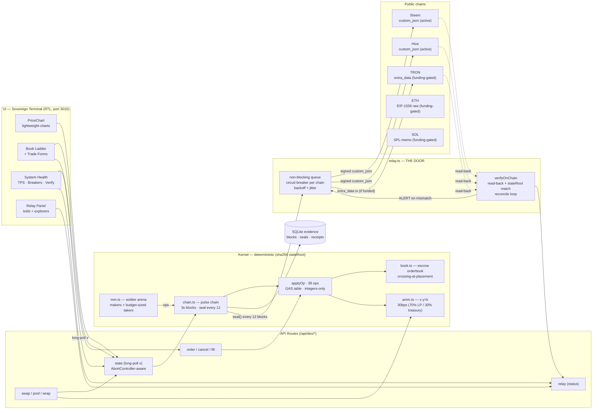

# SAOS-DEX — הבורסה הריבונית של הרשת

> בורסה ריבונית, אוטונומית ואוטומטית על ספר-מקומי — המשך-ישר של ההתחלות מהארכיונים:
> **saos-dex.ts** (ספר-הזמנות כריפליי דטרמיניסטי, ערבות/escrow, מחיר-מייקר) ·
> **grid98.cjs** (מצב-תושב, מיקרו-פעימות, ארנת-חיילים, שער-שוליים, סולם-ערך) ·
> **CHAIN_SPEC.md + kernel.cjs** (טבלת-GAS, שלמים-בלבד, stateRoot).

## ארכיטקטורה — זרימת-נתונים



זרימה: UI (long-poll מבוסס-גרסה) ← API ← Kernel (גרעין דטרמיניסטי + ספר + AMM + ארנה) →
chain.ts חותם מרקל כל-12 בלוקים → Relay משדר ואז **קורא-חזרה מה-RPC** ומאמת את
ה-stateRoot (Circuit breakers + backoff + reconcile). ראיות מתמשכות ב-SQLite.

## מה יש כאן

| רכיב | מימוש | מורשת |
|---|---|---|
| **גרעין דטרמיניסטי** | 38 ops (כולל CoW/launchpad/wrap/truth-rail), טבלת-GAS מהמפרט, dedupe קשיח, stateRoot=sha256(canon) | kernel.cjs · CHAIN_SPEC |
| **ספר-הזמנות** | escrow מלא (sell נועל בסיס · buy נועל ציטוט), מילוי במחיר-מייקר, partial fills | saos-dex.ts |
| **בריכות AMM** | x·y=k שלמים, עמלי-30bps (70% LP · 30% אוצר), שימור-ערך בכל-swap | dex-facts · grid98 |
| **ארנה אוטונומית** | 4 חיילים עושי-שוק + טייק-מסתובב + שער-שוליים (edge ≥ עמלה+מינ') + בוטי-רעש | grid98 "זאן-חיילים" |
| **שרשרת-פעימה** | בלוק כל-3 שנ׳ · חותם-מרקל כל-12 בלוקים · עדי-חיילים (attest ×4) · תמונת-מצב תקופתית | saosnet · grid98 |
| **סולם-ערך** | הרמת-רצפה ≤0.5% לצעד — מגובה אך-ורק בעמלות-שנמדדו (feeMeter) | grid98 מדרגות-ערך |
| **עטיפות 1:1** | wrap_mint/burn עם גיבוי-נעול וכיסוי-מדוד | dex-facts (WSTEEM) |
| **THE-DOOR** | relay/relay_ack באפס-גז — רישום-עבודה-חוצה-רשת | kernel 108 |
| **הוכחות** | verify-pack ציבורי: עלים + שורש + חישוב-מרקל עצמאי מחדש | verify-pack discipline |

## ריצה

```bash
bun install
bun run db:push
bun run dev        # פורט 3010
```

- טרמינל: `http://localhost:3010` (basePath `/saos-dex`) (RTL עברית, זהות מוסדית zinc-950 · lightweight-charts · long-poll)
- API: `/api/dex/state (long-poll ?v=) · settle (עמדת-הסליקה) · showcase (מעבדת-התקפות) · order (order/fill) · cancel · swap · pool · wrap · faucet · arena · wallets · proofs · bench (מקורר-60ש׳) · metrics (Prometheus-text — SETTLE-7) · reset (דורש {"confirm":"WIPE"}) · my-orders · relay`
  (רשימת-השוק החיה היא שדה `markets` ב-`/api/dex/state` — אין-נתיב-`/api/dex/markets` נפרד)
- הוכחת-יכולת: `GET /api/dex/bench?ops=30000` (מדידה-אמת על מצב-טרי)

## כנות-מלאה (העיקרון שלא נוגעים)

- **הספר הוא SIM (מדומה)** — אין כסף אמת, אין עסקאות-נכסים-חוץ, אין הבטחות תשואה.
- **העיגון אמת**: כל-חותם (כל-12 בלוקים) נשדר כ-custom_json חתום-מקומית בסמכות-active
  ל-Steem (כל-חותם) ו-Hive (קצב-נשלט-RC), ו-TRON מותנה-מימון (extra_data). אחרי-כל-txid
  מבוצעת **קריאה-חוזרת ל-RPC הציבורי** והשוואת stateRoot — אי-התאמה = ALERT. אימות-צד-שלישי בסיירים.
- **מפתחות**: זיכרון-בלבד מ-`.env` (gitignored-אומת); אפס סודות בלוגים/פלט/git.
  הארכיטקטורה מוכנה להפרדת Signer–Executor ול-HSM (ראה `ARCHITECTURE_ROADMAP.md` M2).
- כל-דחייה כנה ומוחזרת (`insufficient-escrow`, `min-out`, `no-cross`, `harvest-exceeds-measured-fees`).
- חוסן-Relay: circuit breaker per-chain · backoff אקספוננציאלי-עם-jitter · לולאת-פיוס
  שמאמתת-בדיעבד כל-עיגון שטרם-נבדק (כולל-מהריצות-קודמות).
